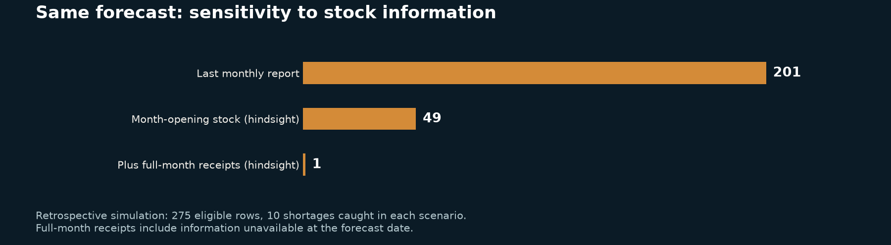
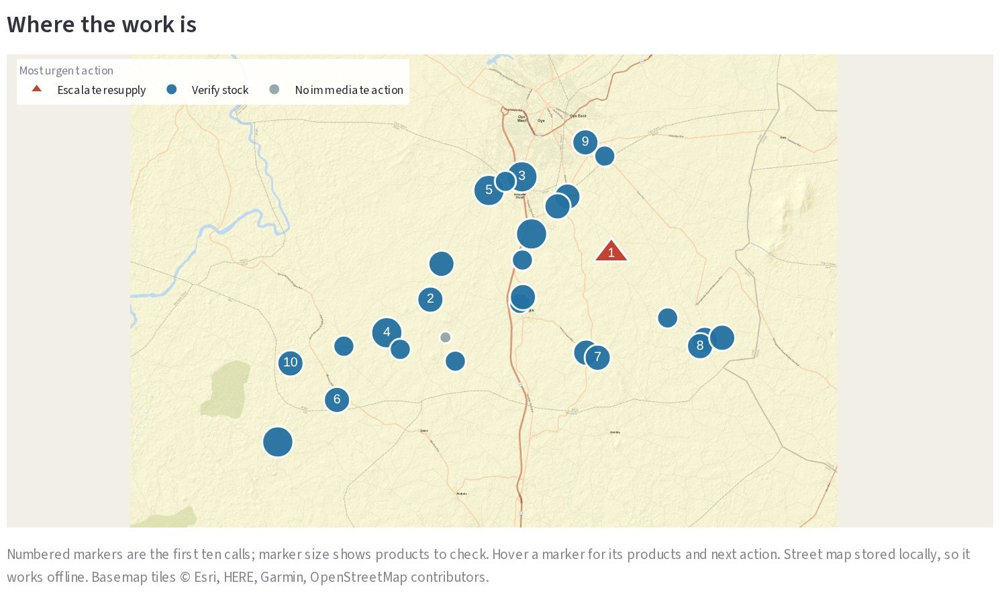
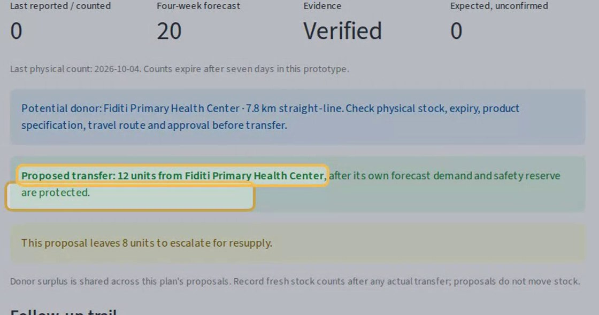

# PHC SupplySignal

**We stopped trying to predict stockouts from stale reports. SupplySignal finds the calls that change decisions, and turns every answer into the next right action.**

Health track · Afijio LGA, Oyo State

## The problem

In Nigeria's 2023 national health facility survey, average essential-medicine availability in public primary health centres was about **34%**. An LGA supply officer oversees dozens of clinics whose monthly stock reports arrive late or not at all, and a report knows nothing about deliveries made since. When oxytocin runs out, a mother bleeding after childbirth pays the price.

## Our insight

The obvious approach is to forecast demand and predict stockouts from the reports. We built that, and the forecast was good: LightGBM cut error by 12% against a three-report average. Yet projected from stale reports it raised about **twenty false alarms for every real shortage**. In a retrospective simulation on 275 eligible rows, true month-opening counts cut false alarms from 201 to 49; full-month receipts cut them to 1, retaining all 10 shortages. Those receipts include hindsight information. The finding motivates SupplySignal's focus on recovering current evidence.

## Working prototype

- **Today's calls.** Flags clinics with missing, late, zero or low reports and forecast gaps, and groups them into ten calls on a map. Ten calls cover 24 product checks.
- **Verify.** The officer records a physical count; the case moves to the right next step.
- **Act.** A counted shortage near a surplus becomes a conditional transfer proposal that protects the donor's reserve and allocates surplus once across requests. With no donor, it escalates. Promised deliveries never count as stock, duplicate receipts are rejected, and every change is logged.

 

**In the demo:** Fiditi's report said **164** units of oxytocin; the count is **40**. SupplySignal proposes **12** units to Abujakan, whose shelf is empty, and escalates the remaining **8**.

## Technical execution

Point-in-time features use chronological splits and seven expanding windows. SHAP shows the six-report average consumption drives the forecast. Experimental conformal ranges improve simulated test coverage from 63.7% to 78.0% against an 80% target. Five executed notebooks rerun from a clean clone to the same model version; 33 unit tests and 15 browser checks cover the safety rules.

## What's a placeholder and what comes next

The prototype runs locally, creates the verification worklist, records checks and receipts, and proposes guarded transfers or escalation. The stock history and demo observations are simulated. The NHLMIS/DHIS2 import is a preview only; it does not yet save an LGA's imported history. SupplySignal is designed to complement national systems, run offline after installation and support paper-based work with a call sheet. **Next:** a proposed four-week pilot with an LGA using authorised monthly exports and a facility roster; measure time to current stock evidence, shortages found per ten calls against current practice, and officer time.

**Data:** 28 real PHCs (GRID3/NHFR registry) and NBS NHFS 2023 tables; the 2,016 monthly stock records are simulated.
